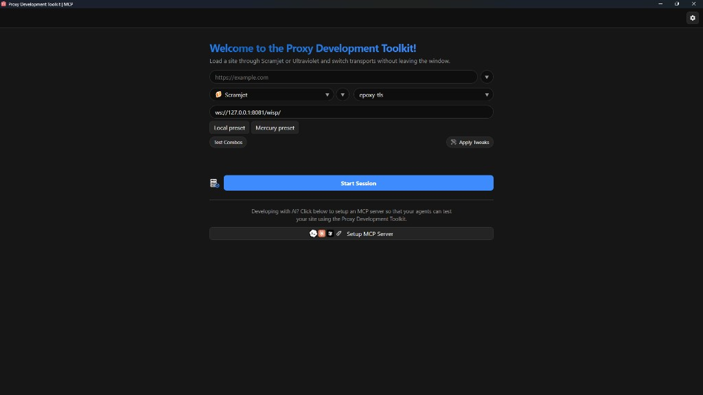
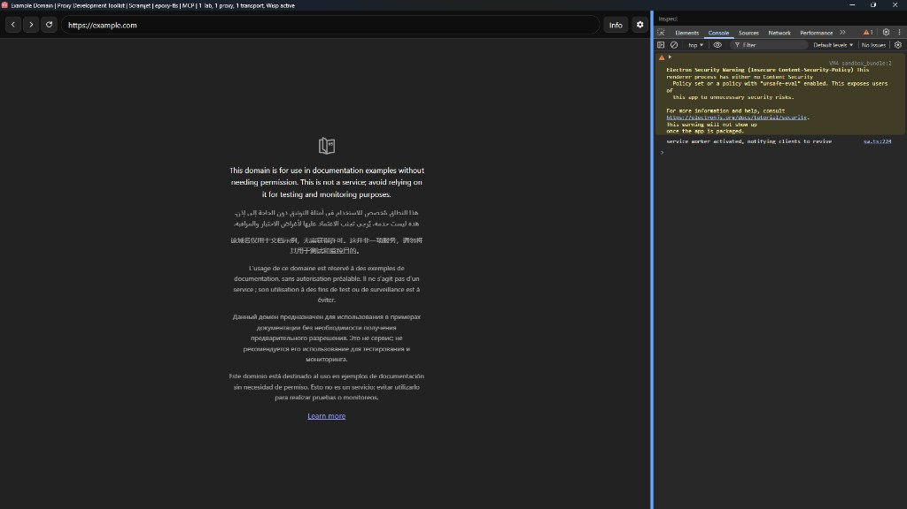
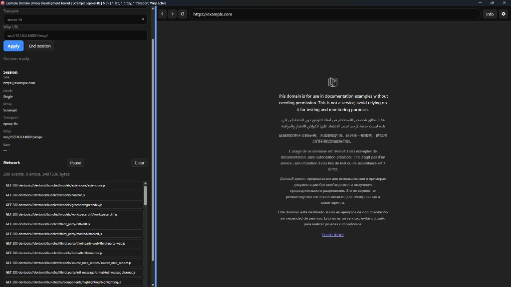

# The future of developing sites for proxies.
Welcome to the Proxy Development Toolkit! Are you developing your site around use with popular proxies such as [Ultraviolet](https://github.com/titaniumnetwork-dev) and [Scramjet](https://github.com/mercuryworkshop/scramjet)? Then this is the app you need.

# Features
- Support for [Ultraviolet](https://github.com/titaniumnetwork-dev) and [Scramjet](https://github.com/mercuryworkshop/scramjet)
- Support for the following transport methods:
- [epoxy-tls](https://github.com/mercuryworkshop/epoxy-tls)
- [wisp-js](https://github.com/mercuryworkshop/wisp-js)
- [libcurl-transport](https://github.com/mercuryworkshop/libcurl-transport)
- [bare-transport](https://github.com/mercuryworkshop/bare-transport)
- [bare-mux](https://github.com/mercuryworkshop/bare-mux)
- Full WSS/Wisp support with local and public Wisp servers
- Ability to test any site via URL (public site) or locally
- Ability to test Ultraviolet and Scramjet (and multiple transport combos) at the same time via Test Combos — each combo opens as a tab, and can pop out to its own window
- Switch proxies/transport methods at any time while testing a site
- Electron DevTools support (based on Chromium DevTools)
- Optional Eruda console injected into proxied pages (lightweight, mobile-friendly; no MCP support)
- Update checks for Scramjet and the transports (epoxy, libcurl, wisp-js, bare, bare-mux), with one-click download from npm and a switch back to the bundled versions
- User agent/screen resolution spoofing
- Ability to export network/DevTools/performance/system/application log info to custom location
- Full MCP support to allow AI agents such as Cursor/Claude/Codex and others to directly interact with the browser environment and test your site using the proxies and transport methods you ask the AI to use

# Screenshots
Home screen — pick a site, proxy, and transport, then start a session.

A proxied session with Inspect open (Chromium DevTools).

Info panel with session details and live network logs.

# System Requirements
This is the bare minimum required for you to be able to use the app, along with what I recommend to have the smoothest experience.
## Minimum/Recommended - Windows
| | Minimum | Recommended |
| - | - | - |
| OS | Windows 10 x64 (1903+) | Windows 11 x64 |
| CPU | Intel Core i3-6100+/AMD A8-7600 | Intel i5-10400+/AMD Ryzen 5 3600 |
| RAM | 4 GB DDR4 | 8-16 GB DDR4 |
| GPU | Intel HD Graphics 530 | Intel UHD 730 |
| Disk | 1 GB | 10 GB
| Network | Required unless testing local site | Required unless testing local site

## Minimum/Recommended - macOS
| | Minimum | Recommended |
| - | - | - |
| OS | macOS 14.6 (Sonoma) | macOS 27 (Golden Gate) |
| CPU | Intel Core i5 (2018+) | Apple M1 |
| RAM | 4 GB DDR4 | 8-16 GB DDR4 |
| GPU | Metal-capable | Apple M1 |
| Disk | 1 GB | 10 GB
| Network | Required unless testing local site | Required unless testing local site

### Note about Intel Mac support
Once Apple ends support for Intel-based apps on macOS versions after 27.x, support for this app will be dropped for Intel Mac devices and you will need a Mac with Apple Silicon to continue recieving updates.
